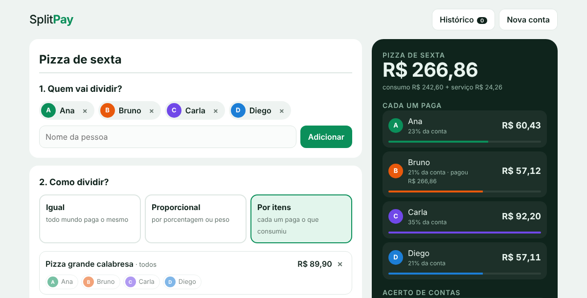

# SplitPay — Divisão de contas

Divida contas entre amigos de forma igual, proporcional ou por itens consumidos e veja quem deve pagar quanto para quem.

🔗 **[Ver o site no ar](https://iamviniciuslima05.github.io/PROJETO-SplitPay/)**



## Funcionalidades

- Divisão **igual**, **proporcional** (% ou partes) ou **por itens**
- Marque **quem consumiu** cada item
- **Taxa de serviço**, gorjeta e desconto distribuídos na proporção
- Cálculo em centavos, **sem sobrar nem faltar centavo**
- Quem pagou: uma pessoa, várias ou ninguém ainda
- **Acerto de contas** com o menor número de transferências
- **Copiar o resumo** para mandar no grupo
- **Histórico** de divisões salvas

## Tecnologias

HTML5 · CSS3 · JavaScript · localStorage

## Estrutura

```
index.html
css/style.css
js/script.js
```

## Como rodar

Não precisa instalar nada: baixe o projeto e abra o `index.html` no navegador, ou acesse a versão publicada acima.

---
Feito por **Vinicius Lima** · [Portfólio](https://viniciuslimadev.netlify.app) · [LinkedIn](https://www.linkedin.com/in/viniciuslima25/)
